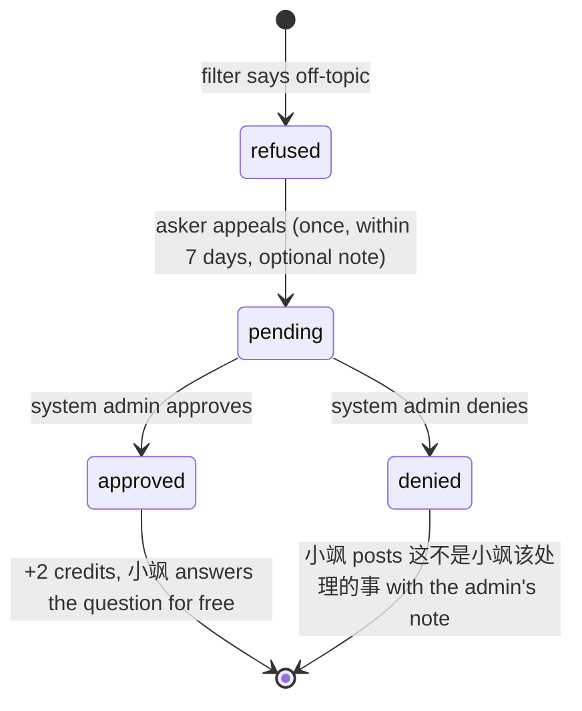

# Feature: AI assistant 小飒 (Sasa)

## Summary

小飒 (Sasa) is CSSA Hub's AI assistant, shown with the animated character in `frontend/public/brand/idle.gif` and `think.gif`. It does three things:

1. **Answers questions in chats with AI mode on.** Anyone in such a chat can write `@小飒` or `@Sasa` to ask what was discussed earlier, which tasks, events or meetings the chat has, or to brainstorm. The answer streams into the chat.
2. **Suggests tasks.** In chats with AI mode on, 小飒 reads each new message and, when someone hands out a task or event or changes one, posts a card with a button that opens the task form already filled in.
3. **A private chat with each member.** Pinned at the top of the chat list and reachable from a floating button on every page, it answers questions about the member's own tasks, deadlines, events and meetings, and about chats with AI mode on that the member takes part in.
4. **Works with documents.** It summarizes a document and finds the tasks, events, announcements and task changes in it ([Document summaries](#document-summaries)); writes or rewrites a document from a prompt, such as turning a transcript into meeting notes ([Writing with 小飒](#writing-with-小飒)); and answers questions about documents attached to a question ([Questions about documents](#questions-about-documents)).

Documents also have **dictation** (听写): the browser's own speech recognition turns speech into text in the document. Dictation doesn't use 小飒 or credits ([Dictation](#dictation)).

Questions cost credits from a weekly allowance. A relevance filter refuses requests that have nothing to do with CSSA work (homework, coursework, random chat), and members can appeal a refusal to the system admins.

The model is served by the UCSB College of Letters & Science AI service ([docs](https://docs.cloud.college.ucsb.edu/AI-LLM)), an OpenAI-compatible API. Code says `ai` and `sasa`; the UI says 小飒 / Sasa.

## AI mode

AI mode is a per-chat switch. It is **off by default**, and only messages sent while it's on can ever be read by the model.

| | |
| --- | --- |
| Chats | 全体 (org), department and group chats. Never DMs or announcement channels. |
| Who switches it | 主席团 and system admins (`viewer.isAdmin`), and only in chats they take part in themselves (not through oversight), and not in read-only (archived or ended) chats. |
| Switching on | Needs `AI_API_KEY` on the deployment. A confirm dialog explains what changes. |
| Effect | Posts a system message ("xxx 开启了 AI 模式…"), writes the audit row `channel.ai_mode`, and stamps `aiEnabledAt` / `aiEnabledBy` on the channel. |

**Indicator.** While AI mode is on, the chat header shows 小飒 (`idle.gif`) in a gold pill. Hovering or tapping it opens a popover: "这个聊天开启了 AI 模式：开启后发送的消息可以被大语言模型（LLM）读取…". The chat list shows a small sparkle next to the chat's name.

**What is readable.** Each message stores `aiReadable: true` when it was sent while AI mode was on (and always in private 小飒 chats). The model only ever receives messages with that flag that are still live (not recalled, removed or expired). Switching AI mode off stops new messages from being readable; messages already flagged stay readable if it's switched on again.

## Asking 小飒 in a chat

- A message is a question when it mentions 小飒 through the `@` picker (小飒 is listed there while AI mode is on) or contains `@小飒` / `@Sasa` typed by hand. The composer shows "这条消息会发给小飒，消耗 1 点额度（剩余 N 点）" and blocks sending at 0 credits or while the previous question is still being answered.
- The question is sent as a normal message. 小飒 immediately posts a reply to it (`kind: "ai"`, quoting the question) that shows `think.gif` and "小飒正在思考…". The answer then streams into that message (written every 400 ms or 200 characters), still with `think.gif`; when it's finished the avatar switches to `idle.gif`. Reduced-motion users see still PNG frames.
- The asker gets a `reply` notification when the answer is finished.
- **Context sent with the question:** that chat's readable messages (the newest 300, plus up to 60 older ones matching keywords picked by the filter), the chat's tasks and events the asker can see under `taskAccess`, and its 集会. Mentions are rendered as names. The whole context is capped at 40,000 characters, dropping the oldest messages first.
- AI messages that are cards (thinking, refusals, notices, suggestions) can't be forwarded or selected. Finished plain answers behave like normal messages.

## Private chat

- One per member: a channel with `type: "assistant"` and `dmKey: "assistant:<userId>"`, created the first time it's opened (`ai.ensureAssistantChannel`), with a welcome message.
- Shown pinned above 全体 in the chat list, and as a floating 小飒 button in the bottom-right corner of every page except 聊天. The button opens the chat in a side panel; it shows `think.gif` while a question is being answered.
- Every message the member sends there is a question (1 credit). No file attachments, task cards, new documents, apps, announcements or notifications; existing documents can be attached to questions ([Questions about documents](#questions-about-documents)). The header shows the credit balance (hover for the rules and next refresh).
- **Context:** the member's own open tasks and events (assigned to or created by them), tasks, events and 集会 in chats with AI mode on that the member takes part in, those chats' readable messages (the 40,000-character budget is split between chats), and the last 10 turns of the private chat.
- **Never included:** content the member can only see through oversight, chats with AI mode off, and DMs.
- **Oversight:** the private chat is overseeable like a DM (主席团 can read everyone's; 部长 can read their members'), with the same banner and audit logging. Overseers see it as "Name · 小飒" and can't post.

## Questions about documents

When a message is a question for 小飒 (in a chat with AI mode on, or in the private chat), the composer shows a **附上文档 / Attach document** button. Up to 3 documents can be attached; they're shown as chips on the question and link to the document.

| Where | Documents that can be attached |
| --- | --- |
| Private 小飒 chat | Any document the asker can open. |
| A shared chat | Only documents everyone in the chat can open: that chat's own documents, documents of that chat's published tasks, and documents in Files outside the 主席团 space (`docSharedIn`). This keeps 小飒 from quoting a document into a chat where some members couldn't open it. |

- Replying to a document card with a question attaches that document automatically.
- `messages.send` rejects (`INVALID`) attachments on a message that isn't a question, more than 3 documents, and documents the sender can't read or that aren't shared-safe for the chat. When the answer is generated, each document is checked again; documents that are gone or no longer allowed are skipped.
- **Context:** each document's text is added as a `<document title="…">` section, sharing a 24,000-character budget between the attached documents, on top of the chat context. The filter sees the attached titles, so "summarize this document" is judged with them.
- The cost is the normal 1 credit per question.

## Document summaries

Under every document there's a **小飒摘要 / Sasa summary** section. Anyone who can read the document can generate or regenerate it for **1 credit**.

- 小飒 (`AI_MODEL_ANSWER`, JSON output) reads the document (the first 24,000 characters) with its context:
  - **Chat documents:** the chat's members and its open tasks the requester can see.
  - **Task documents:** the task's chat members, the task itself and, for an event, its prep tasks.
  - **Files documents:** the people who can be mentioned there; no tasks.
- It returns a **summary** (markdown, up to 4,000 characters) and three lists: **tasks and events** to create (up to 20), **announcements** the document says should be sent (up to 5), and **changes to existing tasks** (up to 10). Assignees and tasks the model names that aren't in the context are dropped.
- The result is **saved with the document** (`aiDocSummaries`), so everyone who can open the document sees the same summary, who generated it and when, and "文档在摘要之后有改动" once the document changes afterwards. Regenerating keeps the links to drafts already created and announcements already sent when the item is the same.
- One summary is generated at a time per document (`AI_BUSY` while it's running). A failed run is refunded and the previous summary stays. Summaries don't go through the relevance filter: the document is already CSSA material.

**What the lists let people do**

- **Tasks and events → drafts.** Each item has 创建草稿, and there's 全部创建为草稿. Drafts are created in the document's chat (for a task document, the task's chat, and prep tasks of an event document are linked to that event); for Files documents the member picks a chat. It needs `canCreateTaskIn` for that chat. Drafts are private to their creator and **notify nobody** until published from the task page; assignees not in the chat are dropped.
- **Announcements.** Each found announcement can be edited and sent to a chat where the member may announce (`canAnnounce`), or to a group chat with AI mode on that they manage. Candidate chats are the document's chat, 全体, department chats and the member's joined chats. In a chat with AI mode on, **小飒 posts it** with "代 xxx 发布" (`ai.actorId`); elsewhere it's the member's own announcement. Either way the chat gets the usual `announcement` notifications, and the summary records where and by whom it was sent.
- **Changes to existing tasks.** Shown to people who can see the task; only its reviewers (`taskAccess.review`) can apply them, and only while the task is open. **修改任务** creates an `edit` suggestion (`aiSuggestions.documentId`) and opens the task form prefilled, exactly like a suggestion card in chat.

## Writing with 小飒

Editors of a document (`canEdit`) can press **小飒写作** above the editor, pick a preset (整理会议纪要, 头脑风暴, 润色, 提炼要点) or write their own prompt (up to 2,000 characters), for **2 credits**.

- The prompt goes through the relevance filter first. A refused prompt costs 2 in total, like a refused question, and can be appealed (approval refunds 2 and runs the prompt for free).
- 小飒 reads the document (first 24,000 characters) and streams markdown into a **private draft** shown above the editor ("只有你能看到"). Nothing is written to the document by the server.
- The editor chooses **追加到末尾**, **插入到光标处** or **替换全文**; the text goes through the collaborative editor, so it syncs and can be undone like typing. **放弃** discards it. Starting a new prompt closes the previous draft.
- **New documents** can start with **让小飒起草**: the prompt is entered in the new-document dialog and runs as soon as the document is created.

## Dictation

Editors see a **听写 / Dictate** button and a language picker (中文 / English, remembered per browser) above the document.

- It uses the browser's Web Speech API (`webkitSpeechRecognition`; Chrome, Edge and Safari, not Firefox). It isn't 小飒: no model call, no credits.
- Final phrases are appended to the end of the document through the editor (a new paragraph after about 300 characters), so collaborators see them live. The phrase still being recognized is shown in a bar under the editor.
- Recognition restarts by itself after pauses until 停止听写 is pressed, and stops if the member loses edit access.
- **Privacy:** Chrome and Edge send the audio to Google's or Microsoft's speech service; Safari may process it on the device. The bar says so while listening.
- **New documents** can start with **边听边记**: the document opens and dictation starts at once (`/docs/?d=…&listen=1`). A typical flow is to dictate a meeting, then ask 小飒 to 整理会议纪要.

## Relevance filter

Every question first goes to a fast model (`AI_MODEL_FAST`) that decides whether it's about CSSA work: tasks, events, meetings, earlier discussions, planning and brainstorming for CSSA, or how to use CSSA Hub. Homework, coursework, exam help, general knowledge, coding help and casual chat are refused. The filter also returns keywords for searching older messages.

- If the filter call fails, the question is treated as relevant (fail open), so an outage of the fast model doesn't block answers.
- **Memory.** System admins can teach the filter: each rule (`aiFilterMemory`, up to 60, 300 characters each) is either 应该回答 / should answer or 不该回答 / shouldn't answer, and they take precedence over the default lists. All rules are read from the database and sent with every filter call (chat questions, private questions and writing prompts), so a new or edited rule applies to the very next request. Rules are written while reviewing an appeal (see below) or added, edited and deleted under **小飒的记忆** on /admin/ai. Every change writes an `ai.memory_change` audit row. Rules go to the AI service with everyone's requests, so they should be general ("为 CSSA 活动出的知识竞赛题") and contain no personal details.
- A refused question becomes a refusal card: "小飒只回答和 CSSA 工作有关的问题", the filter's short reason, and an **申诉 / Appeal** button for the asker.

## Credits

| Role (highest wins) | Credits per week |
| --- | --- |
| System admin | Unlimited |
| 主席团 | 25 |
| 部长 | 15 |
| Everyone else | 5 |

- **Cost:** 1 credit per question (with or without attached documents) and per document summary, 2 credits per writing prompt. A refused question or prompt costs 2 in total (a question is charged 1 more when it's refused), but the balance never goes below 0. Automatic task suggestions and dictation are free.
- **Refunds:** a failed answer, summary or draft (API error, timeout, empty reply) costs nothing. Requests stuck for more than 5 minutes are failed and refunded by a cron every 10 minutes.
- **One at a time:** while a member's question, summary or draft is being generated, another request fails with `AI_BUSY`.
- **Week:** credits refresh every **Sunday at 08:00 Pacific** (`America/Los_Angeles`, DST aware). Usage is counted per week (`weekKey`, the Pacific date of that Sunday); approved appeals add credits in the week they're approved.
- At 0 credits, questions fail with `AI_NO_CREDITS` (the composer already blocks them).

## Appeals

- Every system admin gets an `ai_appeal` notification linking to **/admin/ai**. The appeal stores snapshots of the question and the refusal reason, so it can be reviewed after the chat's retention deletes the messages.
- **Approve:** 2 credits are added (`aiCreditAdjustments`) and 小飒 answers the original question without the filter and without charging. If the question message is gone (or the asker left the chat), only the credits are returned.
- **Deny:** 小飒 posts a notice in the chat ("这不是小飒该处理的事", plus the admin's note if any).
- Either way the asker gets `ai_appeal_reviewed` with the outcome and note, and an `ai.appeal_review` audit row is written.
- **记住这个判断 / Remember this decision** (checked by default) saves a filter rule with the review: approving saves it as "should answer", denying as "shouldn't answer". The rule text starts as the question and should be edited into a general rule before deciding.
- **Writing prompts** are appealed from the refused draft above the editor. Approval refunds 2 credits and runs the prompt again without the filter and without charging, if the member can still edit the document; denial shows the note on the draft. The notification links to the document.

## Task suggestions

Each user message sent in a chat with AI mode on is checked for task work:

1. A cheap keyword and date pre-filter (`lib/ai/prefilter.ts`, Chinese and English) skips messages that clearly aren't about tasks.
2. Up to 60 model calls per chat per hour (`AI_MODEL_FAST`) read the message with the chat's members, its open tasks and the previous few messages, and return `none`, `create_task`, `create_event` or `edit` (with the task to edit) plus title, description, assignees, due date or start and end time, and location. Results with confidence below 0.6 are dropped.
3. 小飒 posts a suggestion card that `@`-mentions the suggested assignees (who get a `mention` notification) and lists the fields.

**The card's buttons**

- **创建任务 / 创建活动** opens `/assignments/new/?c=<chat>&s=<suggestion>` (`&kind=event` for events) for people who can create tasks in that chat (`canCreateTaskIn`).
- **修改任务** opens `/assignments/new/?a=<task>&s=<suggestion>` for people who can review that task (`taskAccess.review`), only while the task is open.
- **忽略 / Dismiss** for the same people.
- Others see "可以在这个聊天里布置任务的人才能采纳".

The form shows "已根据小飒的建议填写，保存前请检查一遍。" and is fully editable. Saving passes `suggestionId`, which marks the card **已采纳 / Applied**. For an open task, suggested new assignees are listed as "保存时添加" and added with `assignments.addAssignees` after saving. A card that's already applied or dismissed opens the plain form.

## Admin page (/admin/ai)

System admins only, under 管理 in the sidebar with a count of pending appeals.

- **Appeals:** pending, approved and denied, each with the member, the chat (private chats are shown only as "私聊小飒") or, for writing prompts, the document's title, the question or prompt, the refusal reason and the member's note. Pending appeals have a note field, the remember option with its rule text, and Approve / Deny.
- **小飒的记忆 / Sasa's memory:** the filter rules, newest first, with who changed them last and whether they came from an appeal; add, edit and delete. Updates live.
- **Usage this week:** questions, refusals and credits used per member, and when credits refresh.
- **Chats with AI mode on:** who switched it on and when.
- A warning when `AI_API_KEY` isn't set.

## Configuration

Set on the Convex deployment (never in the repo). For local work, put them in the gitignored root `.env` and run `npm run ai:env --workspace backend` (add `-- --prod` for production), which copies the `AI_*` variables into Convex without printing them (values go to the Convex CLI through stdin, so they never appear in the process list or shell history). The key is only read inside Convex actions (`lib/ai/client.ts`) and never reaches the browser or the logs.

| Variable | Default | Purpose |
| --- | --- | --- |
| `AI_API_KEY` | none | Bearer token for the UCSB L&S AI service. Without it, AI mode can't be switched on, questions fail with `AI_NOT_CONFIGURED`, and the floating button and the "start a private chat" entry are hidden. |
| `AI_BASE_URL` | `https://api.ai.college.ucsb.edu/v1` | OpenAI-compatible base URL (`/chat/completions`). |
| `AI_MODEL_FAST` | `gemma-4-26b-a4b-it` | Relevance filter and task suggestions (JSON output). |
| `AI_MODEL_ANSWER` | `qwen3.8-27b` | Answers (streamed). `<think>` blocks are stripped. |
| `AI_DRY_RUN` | unset | `true` returns canned answers without calling the API (local development). |

## Data and retention

- AI messages are ordinary `messages` rows (`kind: "ai"`) and follow the chat's retention.
- `aiRequests` (the credit ledger), `aiCreditAdjustments`, settled `aiAppeals` and `aiSuggestions` are deleted after 35 days by a daily cron.
- Writing drafts (`aiDocDrafts`) are deleted after 7 days (the appeal window), applied or not. Text applied to a document is part of the document.
- A document's summary (`aiDocSummaries`) lives as long as the document and is deleted with it. Documents keep a plain-text copy (`documents.text`, up to 30,000 characters) that is refreshed on every save and used for summaries, writing and questions.
- Tables and fields: [03-data-model.md](../03-data-model.md#ai-assistant-stage-4). Permissions: [02-roles-and-permissions.md](../02-roles-and-permissions.md#ai-assistant-小飒). Privacy and the provider: [07-security-and-privacy.md](../07-security-and-privacy.md#ai-assistant-小飒).

## Code map

| Area | Files |
| --- | --- |
| Public API | `backend/convex/ai.ts` (credits, AI mode, private chat, appeals, admin overview, suggestions), `aiMemory.ts` (filter rules; `lib/ai/memory.ts`) |
| Documents | `backend/convex/aiDocs.ts` (summary, drafts from tasks, announcements, task changes, writing, attachable documents), `lib/ai/docs.ts`, `lib/docText.ts` (snapshot to text), `lib/documents.ts` (`documentText`, `docSharedIn`) |
| Model calls | `backend/convex/aiActions.ts` (`answer`, `scan`, `summarize`, `write`), `lib/ai/client.ts` (HTTP, streaming, JSON parsing) |
| Prompts and context | `lib/ai/prompts.ts`, `lib/ai/context.ts` |
| Flow and credits | `lib/ai/flow.ts` (called from `messages.send` and `aiDocs`), `lib/ai/credits.ts`, `lib/ai/sasa.ts` (bot user, mentions) |
| Suggestions | `lib/ai/prefilter.ts`, `lib/ai/suggestions.ts`, `assignments.create` / `update` (`suggestionId`) |
| Frontend | `components/ai/*` (avatar, header indicator, credits, message cards, floating button, document picker, `doc-sasa.tsx` summary and writing panels), `components/docs/dictation.tsx`, `app/(app)/admin/ai/page.tsx` |
| Tests | `backend/tests/ai.test.ts`, `backend/tests/aiDocs.test.ts` (fetch is stubbed; no network) |
